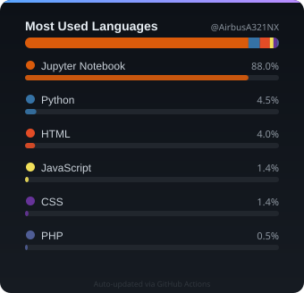

https://github.com/user-attachments/assets/5accc0fd-360d-4ea8-974f-42ba7ffa0739

## 🌐 Socials:
  

# 💻 Tech Stack:

  
  
  
  
  
  
  
  
  
  
  
  
  
  
  
  
  
  
  
  
  
  
  
  
  
  
  
  
  
  
  
  
  
  
  
  
  
  
  

## 📊 GitHub Stats

## Profle Views

